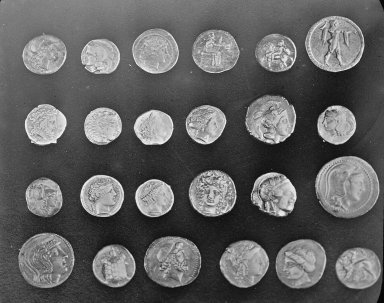
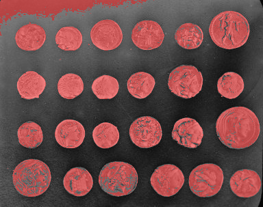
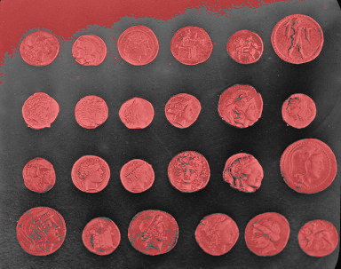
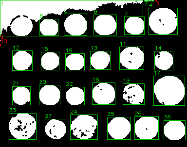
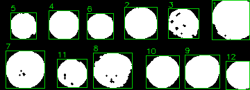

# REPORT — Laboratórios M2.1 e M2.2

**Estudante:** Gustavo Koerich Cardoso

## M2.1 — Máscara binária e segmentação

**Objeto de interesse:** formas geométricas escuras simulando objetos sobre fundos claros. As imagens originais são sintéticas, criadas por `generate_examples.py`, com semente 20261020, sem dependência de direitos de terceiros. A primeira cena apresenta três objetos separados e poucos pixels espúrios. A segunda apresenta iluminação não uniforme, ruído, objetos com contato e um furo claro. Essas condições tornam possível avaliar limitações reais dos limiares. Nenhum arquivo original é modificado pela segmentação.

**Métodos comparados nas mesmas imagens:** `fixed` com `threshold=120`, `invert=true` versus `otsu` com `invert=true`. Ambos operam sobre conversão BGR→cinza; sem suavização prévia. A inversão é necessária porque o alvo é escuro. O limiar fixo classifica valor <= 120 como objeto, e o Otsu define automaticamente um limiar global a partir do histograma.

| Imagem | Método | Pixels brancos | Proporção (%) |
|---|---|---:|---:|
| cena_favoravel | fixed | 9501 | 13.09% |
| cena_favoravel | otsu | 9501 | 13.09% |
| cena_dificil | fixed | 20943 | 28.85% |
| cena_dificil | otsu | 31092 | 42.83% |

**Comparação visual:** A imagem favorável tem resultados idênticos com os dois métodos: os três objetos principais aparecem em branco, mas pequenos ruídos também foram classificados como primeiro plano. Na cena difícil, a diferença entre os métodos é grande: o Otsu inclui uma faixa extensa do fundo mais escuro, criando falso positivo por iluminação não uniforme. O limiar fixo também sofre nessa região; assim, nenhum limiar global resolve completamente a cena difícil.

**Escolha de continuidade:** Usamos Otsu no fluxo demonstrativo M2.2 em ambas as cenas, preservando deliberadamente a cena difícil com erros visíveis para avaliar limites da morfologia e da contagem. Isso não implica que o Otsu seja o melhor método para todas as cenas; na cena difícil o fixed seleciona menos fundo, enquanto métodos locais/adaptativos poderiam ser testados em continuidade.

**Parâmetro sensível:** na limiarização fixa, o threshold muda drasticamente a inclusão do fundo escuro da cena difícil. No Otsu, a distribuição de intensidades do fundo influi no limiar calculado. Falsos positivos conectados ao alvo inflam áreas, fundem regiões e alteram contagens; falsos negativos criam buracos ou fragmentos.

**Figuras:** `images/output/cena_favoravel_fixed_overlay.png`, `images/output/cena_favoravel_otsu_overlay.png`, `images/output/cena_dificil_fixed_overlay.png`, `images/output/cena_dificil_otsu_overlay.png`. As regiões vermelhas são pixels considerados objeto. Máscaras correspondentes estão em `images/output/*_mask.png`. Todas possuem 220×330 pixels, um canal e valores {0,255}, validados por código. As proporções não são métricas de precisão: não foi criada máscara de referência independente.

## M2.2 — Componentes conexos e sequência morfológica

**Máscara inicial:** saída PNG de `segment --method otsu --invert`; o primeiro plano é 255, o fundo é 0. A rotulação com conectividades 4 e 8 é calculada na mesma máscara, excluindo o rótulo zero (fundo). A análise tabular usa conectividade 8, pois considera contato diagonal como conexão. Se dois pixels se tocam somente por um canto, são 2 componentes em 4 e 1 em 8; essa diferença foi conferida por teste sintético.

**Sequência utilizada:** elemento estruturante elíptico de 3×3, 1 iteração por operação; primeiro `open` (erosão seguida de dilatação), para atenuar pixels claros pequenos isolados; depois `close` (dilatação seguida de erosão), para preencher pequenos buracos e frestas. Os PNGs são gravados após cada estágio. Não é esperado que essa sequência separe objetos em contato; fechamento pode até fundir regiões próximas. O filtro `min_area=20` marca os componentes no CSV mas não apaga regiões da máscara.

| Caso | Conex. 4 inicial | Conex. 8 inicial | Inicial bruto | Inicial ≥20px | Área inicial | Final bruto | Final ≥20px | Área final |
|---|---:|---:|---:|---:|---:|---:|---:|---:|
| Favorável | 8 | 8 | 8 | 3 | 9501 | 3 | 3 | 9492 |
| Difícil | 405 | 203 | 203 | 2 | 31092 | 20 | 2 | 30263 |

**Observação 1 (favorável):** o número de componentes brutos cai de 8 para 3, removendo os pixels espúrios; a contagem filtrada permanece 3, coerente com as três figuras. A área de primeiro plano passa de 9501 para 9492 pixels: houve pequena alteração de contornos.

**Observação 2 (difícil):** os componentes brutos caem de 203 para 20, mas a contagem filtrada continua 2. A área cai de 31092 para 30263 pixels. A morfologia remove parte do ruído, porém uma região extensa de fundo erroneamente segmentado persiste; a contagem 2 não deve ser interpretada como número real de objetos. O contato entre dois objetos e a mistura com o fundo impedem correspondência direta entre regiões conexas e objetos humanos.

**Limitação/efeito indesejado:** a abertura pode apagar detalhes finos legítimos; o fechamento pode aumentar ou unir regiões próximas. Na cena difícil, a sequência não corrige a iluminação e não consegue separar objetos em contato. Uma máscara pode ter contagem numericamente baixa e continuar visualmente incorreta.

**Figuras lado a lado:** `results/cena_favoravel_comparison.png` e `results/cena_dificil_comparison.png`, contendo original → Otsu → abertura → fechamento → caixas. Arquivos individuais `_initial.png`, `_stage1_open.png`, `_stage2_close.png`, `_final.png`, `_labels.png` e tabelas `_initial.csv`/`_final.csv` permanecem disponíveis para conferir cada etapa. Os JSONs registram conectividade, parâmetros, ambas contagens, filtro e áreas. A soma das áreas brutas dos CSVs foi conferida por código contra a contagem de pixels brancos.

## Testes e guardas

Foram executados testes de limiar com valores abaixo, no e acima do threshold; dimensões e formato binário; conectividade diagonal 4 versus 8; remoção de ruído pela abertura e preenchimento de furo pelo fechamento; máscara vazia, objeto na borda; conectividade 5, tamanho de kernel par, área negativa, máscara não binária, método desconhecido, threshold fora do intervalo e falha de leitura. Executar `python -m pytest -q`. Os testes passaram no ambiente de validação com OpenCV 4.14.0.

**Transparência:** cenas sintéticas foram usadas como experimentos controlados, não como fotografias reais; não há ground truth independente nem métricas de precisão, revocação ou acurácia. A análise distingue resultado implementado de interpretação visual. Consultar `AI_USAGE.md` antes de submeter.

## Estudo complementar com fotografia real — moedas

Para complementar as cenas sintéticas, foram processadas a fotografia `moedas_original.png` (303×384) e uma segunda entrada `moedas_recorte.png` (130×360), recorte das linhas 160:290 e colunas 10:370 da mesma fotografia. O original está preservado byte a byte; não houve ajuste de brilho ou intensidades no recorte. **São duas entradas reais, mas não duas fotografias independentes**, o que limita a diversidade do estudo. O recorte evita parte do fundo claro superior; o quadro completo apresenta maior dificuldade por sobreposição de intensidades entre moedas e fundo.

Fonte: amostra `coins.png` distribuída no scikit-image 0.24.0, fotografia de moedas gregas de Pompeia, Brooklyn Museum. A documentação da amostra declara “No known copyright restrictions”: https://scikit-image.org/docs/0.24.x/api/skimage.data.html#skimage.data.coins . Nenhum download é necessário para executar o projeto.

Alvo: moedas claras, selecionadas sem inversão. Configurações: cinza, limiar fixo 120 e Otsu automático, sem suavização. Reprodução: `python study_photos.py`. Otsu é usado para a análise, com conectividade 8, filtro de 20 pixels e abertura seguida de fechamento, kernel elíptico 3×3, uma iteração.

| Entrada | Pixels fixed | Pixels Otsu | Proporção fixed | Proporção Otsu |
|---|---:|---:|---:|---:|
| Fotografia completa | 38336 | 45117 | 32,95% | 38,78% |
| Recorte | 17797 | 20281 | 38,03% | 43,34% |

| Entrada | Inicial conex. 4 | Inicial conex. 8 | Inicial filtrado | Final bruto | Final filtrado | Área inicial | Área final |
|---|---:|---:|---:|---:|---:|---:|---:|
| Fotografia completa | 154 | 96 | 26 | 28 | 25 | 45117 | 45234 |
| Recorte | 24 | 14 | 12 | 12 | 12 | 20281 | 20533 |

O limiar fixo exclui detalhes escuros da superfície das moedas; Otsu inclui mais pixels, mas também regiões do fundo claro. A abertura reduz fragmentos pequenos e o fechamento preenche parte das falhas internas, aumentando a área final. A contagem filtrada do quadro completo (25) não é uma contagem confiável de moedas: fragmentação e inclusão do fundo permanecem. O recorte apresenta 12 componentes finais, mas coincidência numérica não comprova correspondência perfeita entre cada região e uma moeda. A limitação de iluminação permanece e exige inspeção visual.

As máscaras, sobreposições, CSVs e imagens de cada estágio estão em `images/output/` e `results/`, com os prefixos `moedas_original` e `moedas_recorte`. A função de análise verifica automaticamente a igualdade entre soma das áreas brutas e quantidade de pixels brancos em cada entrada e saída.
